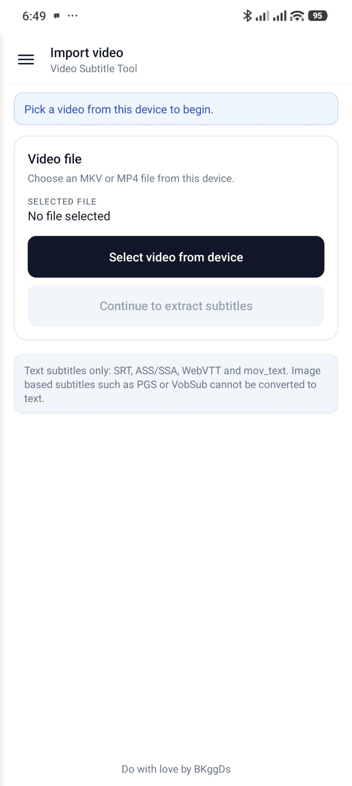
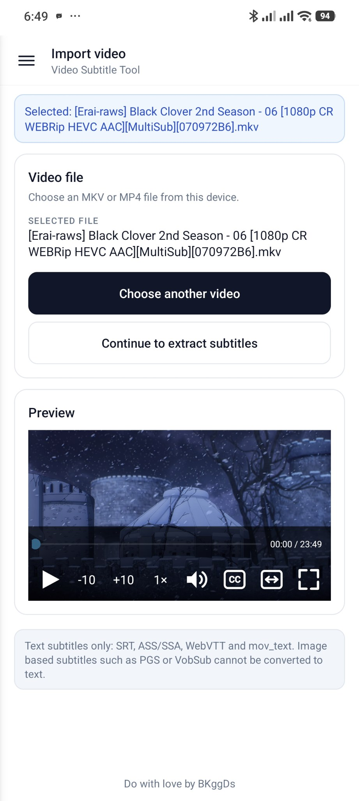
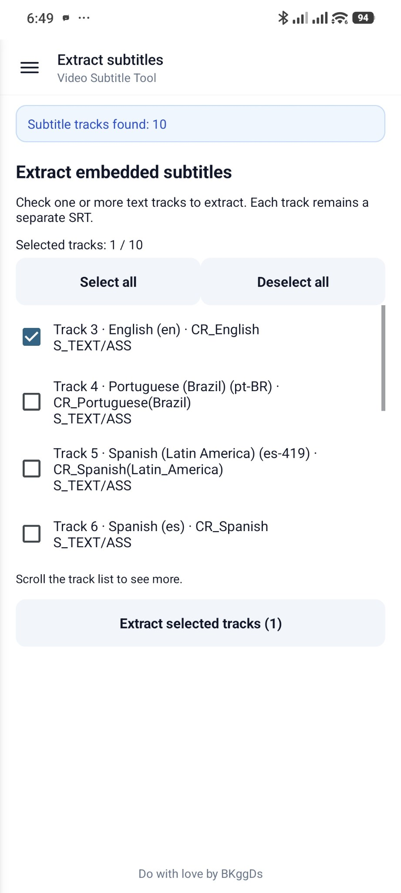
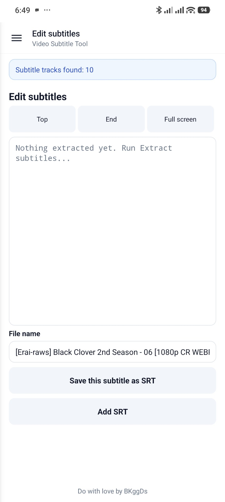
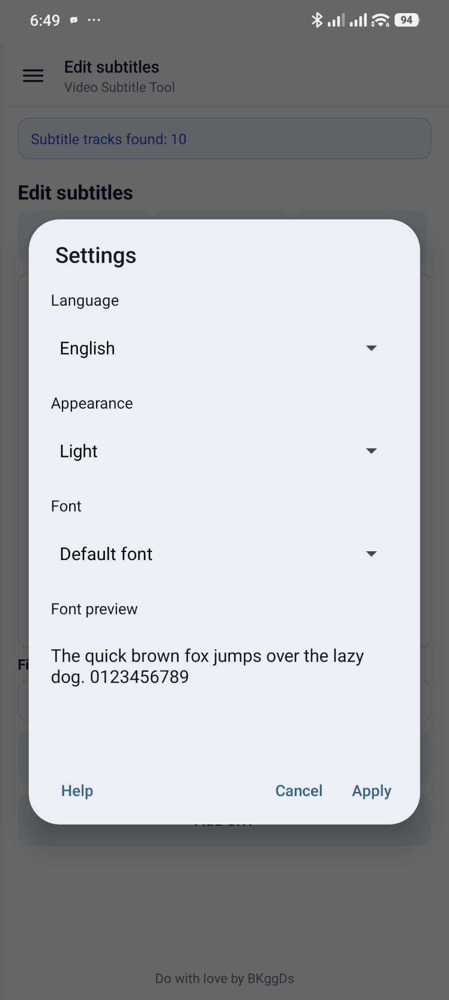

# Video SRT Tool

An Android app for working with video subtitles on the phone: take subtitles out of a video,
add separate subtitles to a video, and watch the video with subtitles.

[English](#english) · [Tiếng Việt](#tiếng-việt)

## Screenshots

  
  
  
  
  

---

## English

### What the app does

- **Import a video** — pick an MKV or MP4 file from the device.
- **See the subtitles inside it** — lists every text subtitle track (SRT, ASS/SSA, WebVTT,
  mov_text), named by language.
- **Extract subtitles** — save one language or every track as subtitle files.
- **Merge / embed subtitles** — add external subtitle files to a video, combine several tracks,
  name tracks by language.
- **Edit subtitles** — open a subtitle in the built-in editor, change the text and save it.
- **Preview the video** — built-in player with a seek bar, ±10 seconds, playback speed,
  audio track and subtitle track menus, aspect ratio (Fit/Fill/Stretch), landscape fullscreen
  and tap/drag gestures.
- **Save files** — choose a folder or save to Downloads.
- **5 interface languages** — English, 中文, 日本語, 한국어, Tiếng Việt.

Only text subtitles are supported: image subtitles (PGS, VobSub) cannot be converted to text.

### Download

Get the APK from the Releases page: https://github.com/Bkhangg/video-srt-tool/releases

Requires Android 7.0 or newer, arm64-v8a.

---

## Tiếng Việt

### App làm gì

- **Nhập video** — chọn tệp MKV hoặc MP4 từ bộ nhớ máy.
- **Xem phụ đề có sẵn** — liệt kê mọi track phụ đề văn bản (SRT, ASS/SSA, WebVTT, mov_text)
  theo ngôn ngữ.
- **Trích xuất phụ đề** — lưu một ngôn ngữ hoặc tất cả các track ra file phụ đề.
- **Ghép / nhúng phụ đề** — thêm file phụ đề rời vào video, ghép nhiều track, đặt tên theo
  ngôn ngữ.
- **Sửa phụ đề** — mở phụ đề trong trình soạn thảo, chỉnh nội dung rồi lưu lại.
- **Xem trước video** — trình phát tích hợp với thanh tua, ±10 giây, tốc độ phát, chọn track
  âm thanh và phụ đề, tỷ lệ khung hình (Fit/Fill/Stretch), toàn màn hình ngang và cử chỉ
  chạm/kéo.
- **Lưu file** — chọn thư mục hoặc lưu vào Downloads.
- **Giao diện 5 ngôn ngữ** — English, 中文, 日本語, 한국어, Tiếng Việt.

Chỉ hỗ trợ phụ đề dạng văn bản: không chuyển được phụ đề ảnh (PGS, VobSub) thành chữ.

### Tải và cài đặt

Tải APK ở trang Releases: https://github.com/Bkhangg/video-srt-tool/releases

Yêu cầu: Android 7.0 trở lên, máy arm64-v8a.
